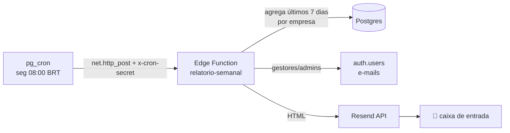

# RF17 — Resumo semanal por e-mail · setup

Envia, toda semana, um e-mail de resumo aos **gestores/admins** de cada empresa:
inspeções da semana, % conformidade, NCs abertas/vencidas por criticidade e as
obras com mais NCs em aberto. Código: `supabase/functions/relatorio-semanal/`.

## Fluxo



## Pré-requisitos (sua parte)

1. **Resend** — na conta que você já usa para o SMTP do Auth:
   - Verifique um **domínio de envio** (ex.: `fieldcheck.app.br`) em Resend → Domains
     (registros SPF/DKIM no DNS). Sem domínio verificado, só dá para enviar ao próprio
     e-mail da conta (bom para teste).
   - Gere uma **API Key** (Resend → API Keys).
2. **Extensões** — aplique a migração `0025_cron_extensions.sql`
   (`node scripts/apply-migration.js supabase/migrations/0025_cron_extensions.sql`),
   ou habilite `pg_cron` e `pg_net` em Dashboard → Database → Extensions.

## Passo a passo

### 1) Secrets da função
```
supabase secrets set \
  RESEND_API_KEY=re_xxx \
  RESEND_FROM="FieldCheck <relatorios@fieldcheck.app.br>" \
  CRON_SECRET=<gere um valor aleatório forte> \
  APP_URL=https://fieldcheck.app.br
```
> `SUPABASE_URL` e `SUPABASE_SERVICE_ROLE_KEY` são injetados automaticamente.

### 2) Deploy (sem verificação de JWT — a função se protege pelo x-cron-secret)
```
supabase functions deploy relatorio-semanal --no-verify-jwt
```

### 3) Teste manual (antes de agendar)
Envie só para uma empresa (troque o `empresa_id` e o `<CRON_SECRET>`):
```
curl -X POST "https://<PROJECT_REF>.supabase.co/functions/v1/relatorio-semanal" \
  -H "x-cron-secret: <CRON_SECRET>" \
  -H "Content-Type: application/json" \
  -d '{"empresa_id":"<uuid-da-sua-empresa>"}'
```
Resposta esperada: `{"ok":true,"empresas":1,"emails_enviados":N,...}`. Confira a caixa
de entrada dos gestores/admins.

### 4) Agendar (rode uma vez no SQL Editor)
`pg_cron` roda em **UTC**. Segunda 08:00 em Brasília (BRT, UTC−3) = **11:00 UTC**.
```sql
select cron.schedule(
  'relatorio-semanal',
  '0 11 * * 1',                        -- min hora dia mês dia-da-semana (1 = segunda)
  $$
  select net.http_post(
    url     := 'https://<PROJECT_REF>.supabase.co/functions/v1/relatorio-semanal',
    headers := jsonb_build_object('Content-Type','application/json','x-cron-secret','<CRON_SECRET>'),
    body    := '{}'::jsonb
  );
  $$
);
```
- Ver agendamentos: `select * from cron.job;`
- Ver execuções:   `select * from cron.job_run_details order by start_time desc limit 10;`
- Remover:         `select cron.unschedule('relatorio-semanal');`

## Comportamento
- Empresas **sem inspeções na semana e sem NCs em aberto** não recebem e-mail (evita ruído).
- Destinatários = usuários **ativos** com papel `gestor` ou `admin` da empresa.
- Falha de envio de um e-mail não interrompe os demais (logada em `console`).

## Pendências / futuras melhorias
- **Opt-out por usuário** (coluna `usuarios.receber_resumo_semanal` + toggle no perfil) —
  não incluído nesta versão; hoje todos os gestores/admins recebem.
- Personalizar cadência/horário por empresa; incluir o logo da empresa no cabeçalho.
