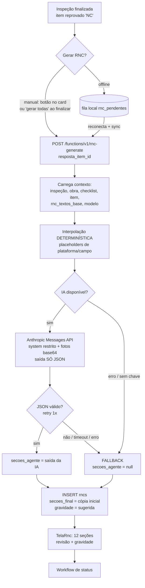
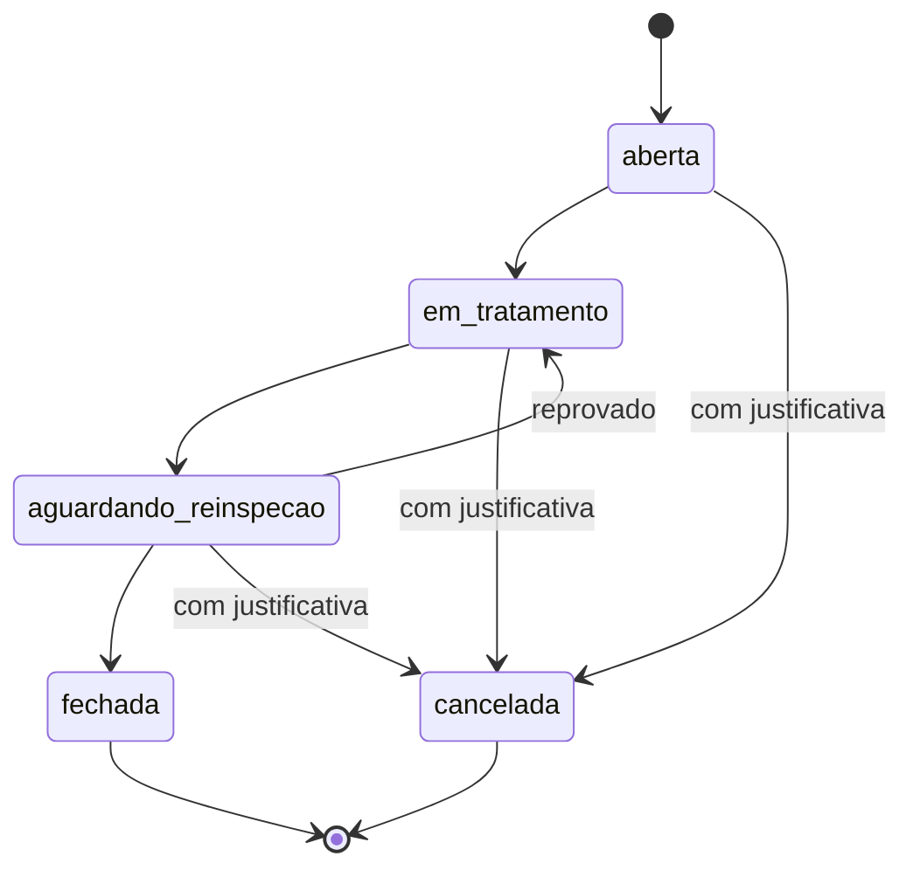

# Módulo RNC — Relatório de Não Conformidade (assistido por IA)

Gera, a partir de um **item reprovado** numa inspeção, um **Relatório de Não
Conformidade** pré-preenchido: textos-base normativos interpolados por código +
lapidação/sugestões por IA. O inspetor/cliente revisa, complementa e formaliza.

**A geração é sempre manual** (opção do cliente/inspetor) — nunca automática. O
módulo **coexiste** com o ciclo leve de tratamento de NC (`eventos_nc`): aquele
segue alimentando Painel de NCs, KPIs e Pirâmide de Bird; a RNC é o **documento
formal** com workflow próprio.

## Fluxo

### Workflow de status da RNC

## Arquitetura

| Camada | Onde | O quê |
|---|---|---|
| DDL + RLS | `supabase/migrations/0023_rnc_module.sql` | enums `rnc_status`/`rnc_gravidade`; tabelas de referência (`rnc_modelos`, `rnc_modelo_checklists`, `rnc_secoes`, `rnc_textos_base`, `rnc_placeholders`); `rncs` (instâncias); `rnc_sequencias` + `next_rnc_numero(empresa_id)`; trigger `updated_at` + espelho `criticidade` |
| Seed | `scripts/gen-seed-rnc.mjs` → `supabase/migrations/0024_seed_rnc.sql` | 643 textos-base · 9 modelos · 83 vínculos · 12 seções · 26 placeholders |
| Backend (IA) | `supabase/functions/rnc-generate/index.ts` (+ `logica.ts` puro) | interpolação determinística → IA (fallback) → persistência |
| Frontend | `src/lib/rncService.ts`, `src/features/rnc/TelaRnc.tsx`, gatilho em `src/features/inspecao/Detalhe.tsx`, diálogo em `src/features/inspecao/Resumo.tsx`, fila `rnc_pendentes` (Dexie v9) | CTA manual, editor das 12 seções, offline, workflow |
| Aplicar migração grande | `scripts/apply-migration.js` | roda `.sql` via `pg` usando `SUPABASE_DB_URL` (pooler de sessão) — o SQL Editor do painel não aguenta a 0024 |

### Reconciliação com o schema real (decisões de modelagem)
- **tenant = `empresa_id`** (não `tenant_id`).
- `checklists.codigo` **não é único** → `checklist_codigo` é texto **sem FK**; integridade validada no seed (bloco `do $$` na 0024) e nos testes.
- `itens_checklist` usa **`ordem`** → `item_numero` = `ordem` do item no catálogo.
- reprovado = `respostas.resposta = 'NC'`; `rncs.resposta_item_id` → `respostas(id)`.
- **gravidade ISO** (`critica|maior|menor|observacao`) com enum próprio + **mapa → criticidade** do Marco I (`critica→critica, maior→alta, menor→media, observacao→baixa`) via trigger, alimentando prazos/SLA/Bird.
- **numeração** `RNC-AAAA-NNNN` por empresa+ano (`unique (empresa_id, numero)`).

### Segredos / configuração (Edge Function)
- `ANTHROPIC_API_KEY` — chave da Anthropic (**só no servidor**, nunca no cliente).
- `RNC_AI_MODEL` — id do modelo (fallback `claude-sonnet-4-6`).
- `SUPABASE_URL` / `SUPABASE_ANON_KEY` / `SUPABASE_SERVICE_ROLE_KEY` — injetados no runtime.
> Após alterar o código/modelo: `supabase functions deploy rnc-generate`.

### Regras invioláveis do agente
Não inventa fatos/normas; não altera citações normativas (NBR/NR/IEC/ONS); preserva
placeholders de fechamento (`{{prazo}}`, `{{responsavel}}`, `{{evidencia_foto_correcao}}`);
só ajusta fluidez ao integrar a descrição; gravidade parte da sugestão do texto-base;
responde **só JSON**. **Falha da IA nunca bloqueia** o registro (fallback determinístico,
`secoes_agente = null`, flag `origem_ia` no retorno).

## Testes

**Automatizados (vitest — offline):**
- `src/lib/rncLogica.test.ts` — interpolação determinística (os **26 placeholders**: substituídos × preservados; casos **com/sem** `exige_projeto_ref`), `parseGravidade`, `tentarParse` (JSON válido / com cerca markdown / campos faltando → `null` → fallback).
- `src/lib/rncSeed.test.ts` — contagens do xlsx (643/9/12/26), 83 checklists sem duplicidade, integridade checklist↔texto-base, 4 seções preenchidas.

**Validado ao vivo (anon key):**
- INSERT anon em `rnc_modelos` → **bloqueado** (42501, RLS). SELECT anon em `rnc_modelos` e `rncs` → **0 linhas**.

**Receitas de validação manual (precisam de DB + 2 usuários / IA):**
- **RLS multi-tenant:** logar como usuário do tenant A, criar RNC; logar como tenant B e
  confirmar que `select * from rncs` **não retorna** a RNC de A. Confirmar que um usuário
  comum (não super_admin) recebe erro ao tentar `insert`/`update` em `rnc_textos_base`.
- **e2e feliz:** reprovar **EL-04 nº 4** → **Gerar RNC** → editar seções 6/7/9/10 →
  definir gravidade (seção 8) → **Salvar** → `→ Em tratamento` → `→ Aguardando reinspeção`
  → **Fechada**. Reabrir o detalhe: botão vira **Abrir RNC** + selo de status.
- **Fallback:** temporariamente com `ANTHROPIC_API_KEY` inválida, gerar uma RNC e conferir
  que ela é criada só com a interpolação (`origem_ia = false`, `secoes_agente = null`).

## Pendências / notas operacionais
- Cota/rate-limit da IA: itens que excederem caem na via determinística (fallback) — o
  registro nunca falha; o "Gerar todas" ao finalizar respeita isso naturalmente.
- Automatizar o e2e (Playwright) e o teste de RLS multi-tenant exigiria usuários de teste
  dedicados + mock/So da IA — hoje são receitas manuais (acima).
